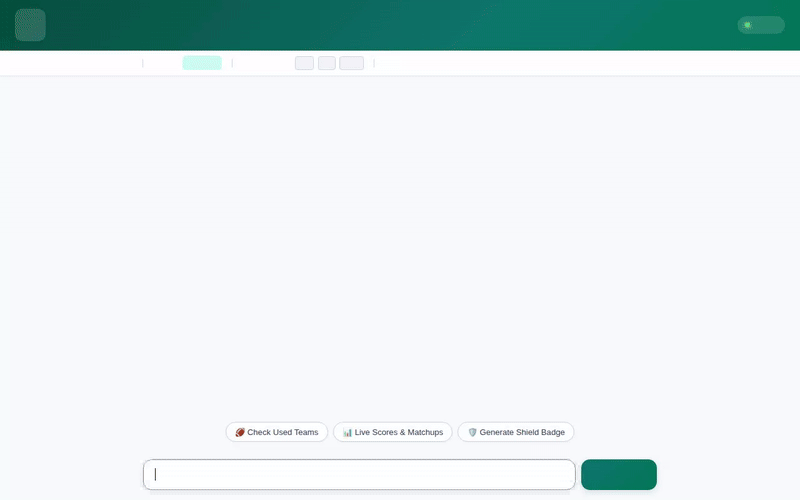

# 🏈 NFL Survivor Pool Strategist

A conversational AI agent built with **Google ADK (Agent Development Kit)** and **A2A (Agent-to-Agent)** protocol that assists NFL Survivor Pool participants in optimizing weekly team selections, tracking used teams, running multi-week expected survival path simulations, and generating custom metallic victory shield badges and celebration videos.



---

## 🌟 Key Features & Capabilities

- **Weekly Matchup & Odds Analysis**: Queries real-time NFL game schedules, point spreads, favorites, and win probabilities.
- **Used Team Tracking & Rule Enforcement**: Enforces the core Survivor Pool constraint—each NFL team can only be picked once per season.
- **Multi-Week Survival Path Simulation**: Executes sandbox python code to simulate optimal pick paths across remaining weeks using Monte Carlo EV calculations.
- **Dynamic A2UI Cards**: Renders interactive, structured UI surfaces (`Card`, `Column`, `Row`, `Text`, `Image`) directly within the chat window.
- **Custom Imagen 3 Victory Badges**: Generates dramatic metallic survivor shield artwork and uploads it to Google Cloud Storage.
- **Omni Model Celebration Videos**: Generates short celebratory MP4 videos using Google's `gemini-omni-flash-preview` model, saves them to the session artifact store, and uploads them to Google Cloud Storage.
- **Durable Memory Bank Integration**: Remembers user pool preferences, favorite teams, and strategy notes across sessions.

---

## ☁️ Google Cloud Services & Architecture

| Service / Component | Implementation Details |
| :--- | :--- |
| **Framework & Protocol** | Google ADK (`google-adk`), A2A Protocol (`a2a-sdk`), FastAPI |
| **Core Model** | `gemini-3.8-flash` |
| **Google Cloud Firestore** | Stores game schedules (`survivor_games`) and user pick histories (`survivor_picks`) |
| **Vertex AI Memory Bank** | Durable long-term memory service (`VertexAiMemoryBankService`) for cross-session context |
| **Vertex AI Code Executor** | Isolated code execution sandbox (`AgentEngineSandboxCodeExecutor`) for survival algorithms |
| **Google Cloud Storage (GCS)** | Public storage bucket for hosting generated victory badges and celebration video assets |
| **Imagen 3 (`imagen-3.0-generate-002`)** | AI image generation for custom Survivor victory shield badges |
| **Google Omni (`gemini-omni-flash-preview`)** | AI video generation for short team celebration videos |
| **A2UI Schema & Catalog** | `a2ui.basic_catalog` for dynamic native frontend component rendering |

---

## 🛠️ Implemented Agent Tools

The agent is powered by 8 specialized tools defined in `app/agent.py`:

1. `get_weekly_schedule_and_odds(week: int)`: Queries Firestore for game matchups, point spreads, and win probabilities for a specified week.
2. `get_used_teams(user_id: str)`: Fetches all teams previously selected by the user to prevent duplicate picks.
3. `record_survivor_pick(picked_team: str, week: int, user_id: str)`: Records a new weekly pick in Firestore after validating availability.
4. `simulate_survivor_path(user_id: str, remaining_weeks: int)`: Runs a Python sandbox script to calculate optimal multi-week survivor paths and expected survival probabilities.
5. `fetch_real_nfl_scoreboard(week: int)`: Retrieves live scores and game statuses for the given week.
6. `generate_survivor_badge(picked_team: str, week: int)`: Uses Imagen 3 to generate a custom metallic victory shield, saves it to GCS, and returns a public HTTPS URL.
7. `generate_survivor_video(team_name: str, celebration_style: str)`: Uses `gemini-omni-flash-preview` in the global region to generate a short MP4 video, saves it via `tool_context.save_artifact`, uploads to GCS, and returns its public URL.
8. `PreloadMemoryTool()`: Preloads durable memory facts from Vertex AI Memory Bank into the agent's turn context.

---

## 🚀 Local Setup & Running Instructions

### Prerequisites
- Python 3.11+
- `uv` package manager (`pip install uv`)
- Authenticated Google Cloud Application Default Credentials (`gcloud auth application-default login`)

### Installation & Execution

1. **Clone the repository and enter the project directory**:
   ```bash
   cd nfl-survivor-agent
   ```

2. **Install dependencies using `uv`**:
   ```bash
   uv sync
   ```

3. **Start the local FastAPI server & web client**:
   ```bash
   uv run uvicorn frontend.main:app --host 127.0.0.1 --port 8080
   ```

4. **Access the application**:
   Open a web browser and navigate to `http://127.0.0.1:8080` to interact with the NFL Survivor Pool Strategist.

---

## 📁 Repository Structure

```
nfl-survivor-agent/
├── app/
│   ├── agent.py               # Root ADK Agent, tools, and callbacks
│   ├── a2ui_utils.py          # A2UI callback transformer
│   └── __init__.py
├── frontend/
│   ├── main.py                # FastAPI server & A2A protocol proxy client
│   └── static/
│       ├── index.html         # Stadium-themed frontend & A2UI surface renderer
│       └── ...
├── agents-cli-manifest.yaml   # Google Agents CLI deployment manifest
├── deployment_metadata.json   # Deployment runtime target metadata
├── demo.gif                   # Looping demonstration recording
└── README.md                  # Project documentation
```
